# kuandai-manager

**宽带账号台账 + 充值提醒 + AI 助手 —— 一个 Docker 容器搞定。**

[](https://github.com/zozlio/kuandai-manager/actions/workflows/docker-publish.yml)
[](https://github.com/zozlio/kuandai-manager/releases)


[](LICENSE)

[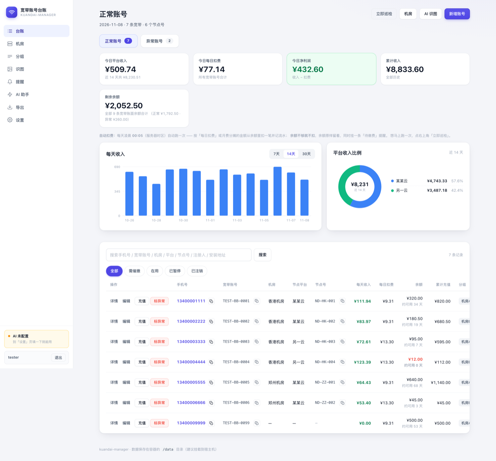](preview/dashboard.svg)

给宽带代办点 / 运维人员用：把每个电话号码绑定的宽带账号、注册码、注册人、注册时间、套餐费和剩余金额集中记下来，系统**每天按套餐自动扣一点余额**、余额不够自动生成催缴提醒，还能直接用大白话问 AI、传一张收益截图让 AI 帮你记账。

**当前版本 v1.2.0** ｜ 改动明细与升级步骤见 [CHANGELOG.md](CHANGELOG.md)

---

## 目录

- [v1.2.0 更新亮点](#v120-更新亮点)
- [功能一览](#功能一览)
- [快速开始](#快速开始)
- [在页面上配置 AI](#在页面上配置-ai推荐)
- [环境变量](#环境变量)
- [使用流程](#使用流程)
- [导出与备份](#导出与备份)
- [目录结构](#目录结构)
- [界面预览](#界面预览)
- [本地开发与测试](#本地开发与测试)
- [从旧版本升级](#从旧版本升级)
- [飞牛 fnOS NAS 部署](#飞牛-fnos-nas-部署本项目在-fnos-上实测部署成功)
- [常见问题](#常见问题)
- [上线建议](#上线建议)

---

## v1.2.0 更新亮点

> 完整清单、行为改动和注意事项见 [CHANGELOG.md](CHANGELOG.md)。

| | 改动 | 一句话说明 |
|---|---|---|
| 🎨 | **全新 v2 界面** | 玻璃拟态 + 深色霓虹 + 背景浮动光球；KPI 卡片 3D 景深、数字滚动、图表动效增强；尊重系统「减少动态效果」设置，开了就自动降级 |
| 🔍 | **AI 识图链路修通** | 从「识别」一路修到「匹配 → 回填」：以**节点号**为主键识别、命中多条绝不静默选一条、每行可手动选账号、无日期默认「昨天」、429/503 自动重试、超时给中文提示 |
| ✏️ | **宽带账号改为可编辑** | 以前建完就锁死，现在可以改；带唯一性校验，改成别人占用的号码会被拒绝 |
| 🧹 | **三处入口下线** | 分组功能、安装地址、手动「发起催缴」入口全部移除。**自动扣费和余额不足自动催缴原样保留**；相关数据库表和字段**刻意保留不删**，不会丢历史数据 |
| 🐛 | **修掉首页底部 JS 乱码** | 首页 / 基础模板里的脚本曾被重复注入 2–3 次，泄漏成页面文本，已清理为各 1 份 |
| ⚙️ | **识图可调参数** | 新增 `VISION_TIMEOUT`（默认 300 秒）与 `AI_MAX_TOKENS`（默认 8192），识别超时 / 截断都会给出明确提示 |
| ✅ | **回归测试 69 → 82 项** | 全绿；v1.1.0 → v1.2.0 **不需要数据迁移**，换镜像重启即可 |

---

## 功能一览

| 模块 | 说明 |
|---|---|
| **登录注册** | 首页自带登录/注册。第一次用的人自己设账户名和密码，**账户名和密码格式都不限制**（中文、空格、符号都行），只要不是空的 |
| **台账** | 电话号码、宽带账号、宽带注册码、注册人、**手机卡使用人**、注册时间、套餐原价、剩余金额、累计充值、运营商、备注 |
| **开号送 500** | 新建账号自动带 ¥500 初始余额，并记一笔「开号初始金额」流水 |
| **充值** | 列表页每行一个「充值」按钮，弹窗输入金额，确认后余额和累计充值同时更新，全程有确认/取消弹窗 |
| **七折开关** | 套餐原价 ¥399 打七折 = ¥279.30；开关一旦打开就锁死，不能再关（后端强制） |
| **按天扣费** | 月费 ÷ 当月天数 = 每日扣款额，每天自动从余额里扣一笔，月末补齐余数，整月刚好扣满一个月费 |
| **充值提醒** | 列表页实时打标（正常 / 余额偏少 / 余额不足），另有独立的催缴提醒页 |
| **收支流水** | 充值、扣费、手动调整全部留痕，余额变动可追溯 |
| **AI 问答** | 「哪些账号需要催缴？」「这个月一共要交多少钱？」直接问，AI 基于你的真实台账回答 |
| **AI 催缴话术** | 一键给待催缴账号生成一条 80 字内的催缴短信 |
| **页面设置** | 侧边栏「设置」页填接口地址、密钥、模型名，保存即生效，**不用重启容器** |
| **正常 / 异常分类** | 账号分两大类，首页用两个不同颜色的标签页切换；标记异常时可从「机房 / 当前电费 / 管理线 / 限速 / 注销 / 欠费」里选原因并写备注，异常账号可一键恢复 |
| **机房 / 平台 / 节点号** | 层级是 **机房 → 节点平台 → 宽带账号 ＋ 节点号**，一条宽带唯一对应一个节点号；机房、节点平台、节点号、**宽带账号**都是账号自己的字段，随时可改 |
| **收入看板** | 首页显示今日平台收入、今日每日扣费、净利润（收入 − 扣费）、近 7/14/30 天收入柱状图、平台收入占比环形图；**数字口径跟着当前标签页走**，正常页只算正常账号 |
| **AI 识图** | 上传收益截图，AI **以节点号为主键识别**（宽带账号有则一并抄），把每天的收益金额认出来；识别结果先进可编辑确认表（每行可手动选账号、可改日期），人工确认后才写进台账 |
| **一键复制** | 手机号、节点号、宽带账号旁边都有复制按钮，点一下就复制，不用手动框选 |
| **运营商下拉** | 运营商改成下拉框选，不用手打 |
| **数据导出** | 侧边栏「导出」页下载 CSV（台账 / 机房 / 每日收入 / 收支流水，Excel 直接开不乱码），另有全量备份 JSON 可一键还原 |
| **自动扣费** | 每天凌晨 00:05 自动扣一次（余额不够就不扣，挂待缴费提醒），首页也能点「立即巡检」马上跑 |

数据存在容器的 `/data` 目录（一个 SQLite 文件），挂载到宿主机即可备份和迁移。

### 退役功能登记

刻意下线、但**数据完整保留**的功能，记录在此避免以后误删表或误判成半成品：

| 功能 | 状态 | 说明 |
|---|---|---|
| **分组（account_groups）** | 已退役，只读保留 | UI 入口、路由、模板、测试断言已移除，账号 CSV 也不再导出「分组」列。但 `account_groups` 表和 `accounts.group_id` 字段**保留不删**——历史数据还在库里，只是界面不再展示和操作；全量备份 JSON 仍会导出这张表，还原时分组信息不会丢。**这不是死代码，请勿当成无用表清掉。** |
| **安装地址（accounts.install_address）** | 已退役，只读保留 | 界面（列表 / 详情 / 表单）、导出 CSV 列、导入映射、搜索条件里的「安装地址」全部移除——内容和「机房」重复。字段**保留不删**，历史数据还在库里。 |
| **手动发起催缴** | 已退役 | 账号详情页的「发起催缴」表单 / 按钮、`POST /accounts/{id}/remind` 路由、`create_manual_reminder` 函数、`REMIND_MANUAL` 类型及其「人工催缴」标签均已移除。**自动扣费与余额不足自动催缴完整保留。** |

> 退役口径：三者移除都不影响扣费 / 催缴 / 收入等核心逻辑。数据库表与列保留是刻意的，防止误删已有数据。

---

## 快速开始

### 方式一：直接用构建好的镜像

```bash
docker run -d \
  --name kuandai-manager \
  --restart unless-stopped \
  -p 8080:8080 \
  -v /opt/kuandai-manager/data:/data \
  -e TZ=Asia/Shanghai \
  ghcr.io/zozlio/kuandai-manager:latest
```

### 方式二：自己构建

```bash
git clone https://github.com/zozlio/kuandai-manager.git
cd kuandai-manager
docker build -t kuandai-manager:latest .
docker run -d --name kuandai-manager --restart unless-stopped \
  -p 8080:8080 -v /opt/kuandai-manager/data:/data \
  -e TZ=Asia/Shanghai kuandai-manager:latest
```

或者用仓库里的 compose：

```bash
docker compose up -d
```

浏览器打开 <http://服务器IP:8080> 即可使用。

> **第一次打开**：首页会让你创建管理员账户 —— 填一个账户名和密码就行，**不限制格式**（中文、带空格、带符号都能用），只要不是空的。创建完就自动登录进台账。之后侧边栏底部可以随时退出。

> AI 相关的环境变量不填也能正常用，只是 AI 问答和话术生成会提示「未配置」—— 这时候打开网页左侧的「设置」页填上就行，保存即生效，不用重建容器。

---

## 在页面上配置 AI（推荐）

打开网页 → 左侧「设置」→ 填三项：

| 填什么 | 例子 | 说明 |
|---|---|---|
| 接口地址 | `https://api.deepseek.com/v1` | 填到域名就行，系统自动补 `/v1` |
| 密钥 | `sk-xxxxxxxx` | 存下来了，页面上只显示尾巴 4 个字符，不会明文回显 |
| 模型名 | `deepseek-chat` | 你账号下能用的那个 |

三个按钮：

- **保存配置** —— 存下来，立刻生效（有确认弹窗）
- **测试连接** —— 真发一条消息验证地址/密钥/模型对不对，不改任何配置
- **恢复环境变量** —— 清掉页面上的配置，回落到容器启动时的环境变量

配置存在同一个 SQLite 文件里，跟着 `/data` 一起备份迁移。页面上的配置**优先于**环境变量；某一栏留空，这一项就回落到环境变量。

> ⚠️ **AI 识图必须单独配一个支持图像输入的视觉模型**（如 `MiniMax-M3-VL-01`、`qwen-vl-plus`、`gpt-4o`），
> 用纯文本模型跑识图会识别不出来。设置页里视觉模型和问答模型是分开填的。

---

## 环境变量

### AI 接口（OpenAI 兼容协议，换服务商只需改 base_url）

| 变量 | 必填 | 说明 |
|---|---|---|
| `AI_BASE_URL` | 否 | 接口地址，建议带 `/v1`。填了不带会自动补上。页面设置优先于此项 |
| `AI_API_KEY` | 否 | 密钥。页面设置优先于此项 |
| `AI_MODEL` | 否 | 模型名，填你账号下可用的那个。页面设置优先于此项 |

常见服务商示例：

| 服务商 | `AI_BASE_URL` | `AI_MODEL` 示例 |
|---|---|---|
| MiniMax 中国版（可选） | `https://api.minimaxi.com/v1` | 问答 `MiniMax-M3`；**识图用视觉模型 `MiniMax-M3-VL-01`** |
| MiniMax 国际版（可选） | `https://api.minimax.io/v1` | 以控制台可用模型为准 |
| DeepSeek | `https://api.deepseek.com/v1` | `deepseek-chat` |
| 通义千问（DashScope 兼容模式） | `https://dashscope.aliyuncs.com/compatible-mode/v1` | 问答 `qwen-plus`；识图用 `qwen-vl-plus` |
| OpenAI | `https://api.openai.com/v1` | 问答 `gpt-4o-mini`；识图用 `gpt-4o` |
| 本地 Ollama | `http://host.docker.internal:11434/v1` | 你的本地模型名（识图需支持视觉的模型） |

> ⚠️ 国内密钥必须配国内域名（`api.minimaxi.com`），国际密钥配 `api.minimax.io`，混用会报 `invalid api key`。老的 `api.minimax.chat` 域名已废弃，不要再用。

### 存储与调度

| 变量 | 默认值 | 说明 |
|---|---|---|
| `DATA_DIR` | `/data` | 数据库存放目录 |
| `DATABASE_URL` | 空 | 自定义数据库地址，默认 `sqlite:////data/kuandai.db` |
| `ENABLE_SCHEDULER` | `true` | 关掉定时任务（设为 `false`） |
| `DAILY_CHECK_HOUR` | `0` | 每日扣费巡检的小时（0-23），默认凌晨 0 点 |
| `DAILY_CHECK_MINUTE` | `5` | 每日扣费巡检的分钟 |
| `AI_TIMEOUT` | `120` | AI 接口超时秒数 |
| `AI_TEMPERATURE` | `0.3` | AI 回复随机性，催缴话术生成时会单独调高 |
| `VISION_TIMEOUT` | `300` | AI 识图专用超时秒数（识别约需 1-2 分钟，图信息量大可调大） |
| `AI_MAX_TOKENS` | `8192` | 视觉识别生成上限，防止思考型模型无上限卡到超时；截断会给出明确提示 |
| `SESSION_COOKIE_SECURE` | `false` | 改成 `true` 表示登录 cookie 只走 HTTPS。**正式对外访问时建议开**，但前面得有 Nginx 配好 HTTPS，否则会登不上 |

---

## 使用流程

1. **开号** —— 列表页「新增账号」，填手机号、宽带账号、注册码、注册人、手机卡使用人、注册时间、套餐原价（默认 399），保存后系统自动带 ¥500 初始余额，并记一笔「开号初始金额」流水
2. **要优惠就开七折** —— 编辑页打开「套餐七折优惠」开关，实际月费立刻变成 ¥279.30，每天扣款额同步变成 ¥9.31。**开关一旦打开就锁死**，避免账目来回改
3. **每天自动扣** —— 每天凌晨自动巡检：月费 ÷ 当月天数 = 每日扣款，从余额里扣一笔并记流水；月末会补齐余数，保证整月加起来正好等于一个月费
4. **余额不够** —— 扣不动时不扣款（余额保留着），改生成「待缴费」提醒，催缴页能一键生成话术
5. **客户充值** —— 列表页每行点「充值」→ 弹窗填金额（可点 +100/+200/+500 快捷键）→ 弹窗实时显示「充值后余额」→ 点「确认充值」，余额和累计充值一起更新，全程有确认/取消按钮
6. **查账** —— 账号详情页有「收支流水」，充值、扣费、手动调整全部留痕；AI 助手页直接问：「13800138000 这个账号什么情况」「哪些欠费最多」

> 所有会改数据的操作（保存、充值、删除）都会先弹确认框，点「取消」不会有任何改动。

---

## 导出与备份

数据只有一个文件：`/data/kuandai.db`

### 用页面导出（更方便，不用进服务器）

侧边栏「**导出**」页可以下载：

| 文件 | 内容 |
|---|---|
| 台账导出 CSV | 所有账号：余额、累计充值、每日扣费、机房、节点平台、节点号、异常原因 |
| 每日收入导出 CSV | 按天的收益金额，带机房、节点平台、节点号，含来源（手工 / AI 识图） |
| 收支流水导出 CSV | 所有充值、扣费、调整记录 |
| 全量备份 JSON | 整个数据库的完整快照，**可以用来还原** |

CSV 都带 BOM，Excel / WPS 双击打开不会乱码。

### 命令行备份

```bash
# 备份
docker exec kuandai-manager tar -czf - -C /data kuandai.db > ~/kuandai-$(date +%F).db.tgz

# 或者直接复制宿主机上的文件
cp /opt/kuandai-manager/data/kuandai.db ~/backup/
```

### 从全量备份恢复

```bash
python3 scripts/restore_backup.py 备份文件.json --yes
```

脚本会先把当前库另存为 `kuandai.db.恢复前_时间戳`，再写入备份内容；中途出错会自动把原库放回去，不会让你对着空库发愣。

> ⚠️ 导出的文件含手机号、宽带账号，全量备份里还有密码哈希 —— 都当敏感文件保管。

---

## 目录结构

```
kuandai-manager/
├── Dockerfile
├── docker-compose.yml
├── requirements.txt
├── app/
│   ├── main.py          # 路由与页面
│   ├── auth.py          # 账户、密码哈希、登录会话
│   ├── models.py        # 数据表：台账 / 流水 / 提醒 / 用户 / 配置 / 每日收入（account_groups 只读保留）
│   ├── services.py      # 扣费、充值、提醒、统计、看板、图表、视觉配置、识图匹配
│   ├── exporting.py     # 数据导出：CSV 与全量备份 JSON
│   ├── ai.py            # AI 问答与话术生成
│   ├── vision.py        # AI 识图：调用视觉模型 + 解析识别结果
│   ├── scheduler.py     # 每日自动扣费
│   ├── database.py      # SQLite 连接与字段迁移
│   ├── config.py        # 环境变量配置
│   └── templates/       # 页面模板
├── static/style.css
├── scripts/
│   ├── entrypoint.sh    # 容器启动脚本
│   ├── dev_local.sh     # 本地预览（改代码看效果）
│   ├── seed_demo.py     # 灌一批演示数据（只写本地库）
│   ├── make_preview_svg.py  # 生成 preview/ 里的预览图
│   └── restore_backup.py    # 从全量备份 JSON 恢复数据
├── preview/             # 界面预览图（SVG）
└── tests/
    └── test_regression.py  # 回归测试（82 项）
```

---

## 界面预览

> 全部预览图在 [`preview/`](preview) 目录。仓库里存的是 SVG（内嵌 PNG），体积小、放大不糊。

| 台账列表 | 首页看板 |
|---|---|
| 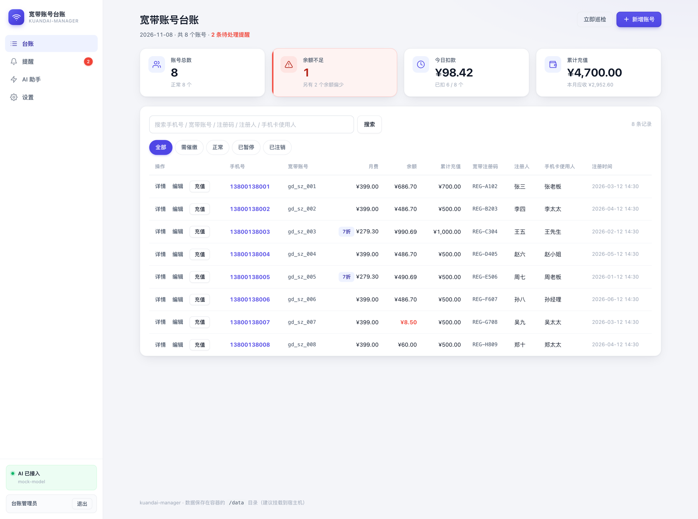 |  |

| AI 识图 | 数据导出 |
|---|---|
| 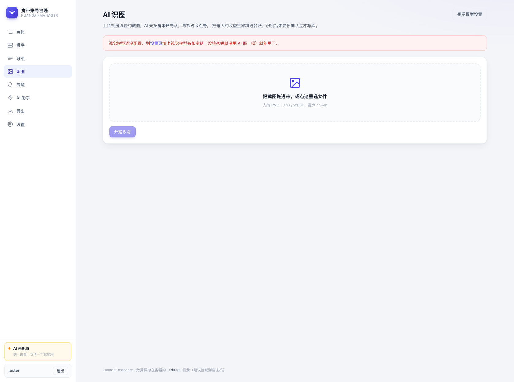 | 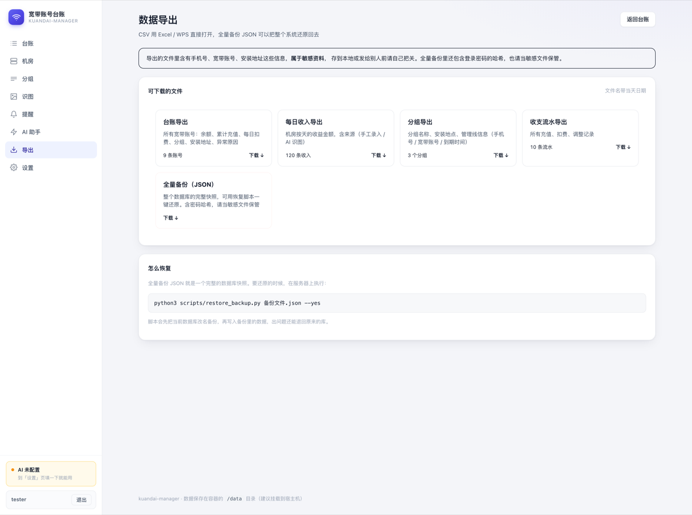 |

| 机房总览 | 催缴提醒 |
|---|---|
| 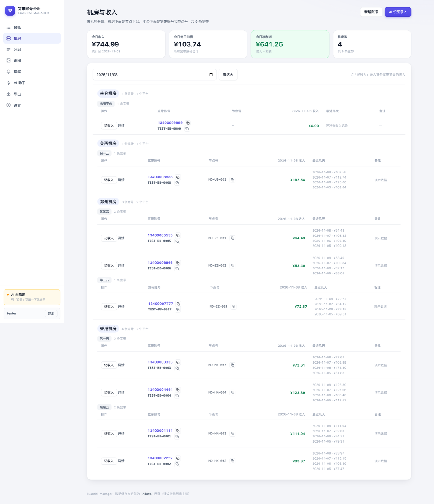 | 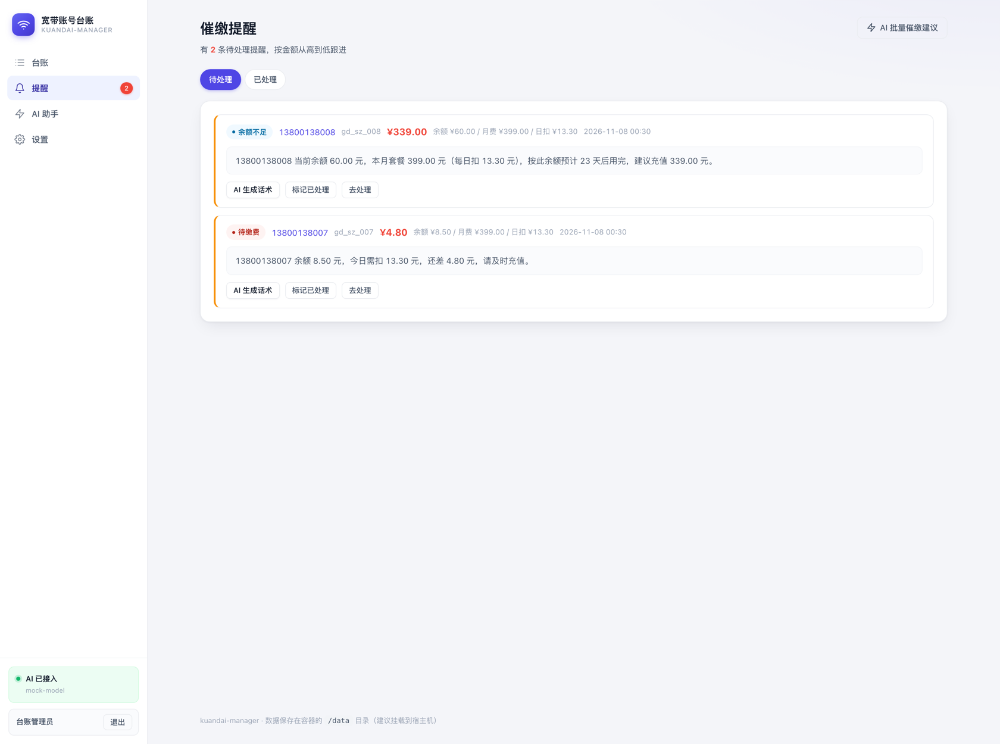 |

| 账号详情 | 充值弹窗 |
|---|---|
| 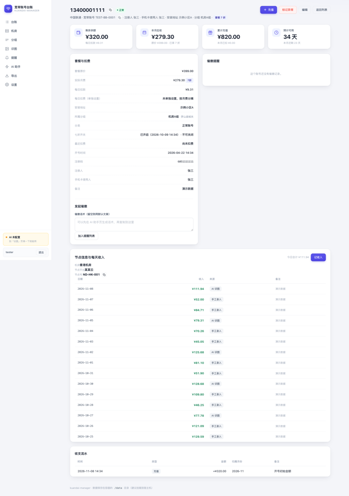 | 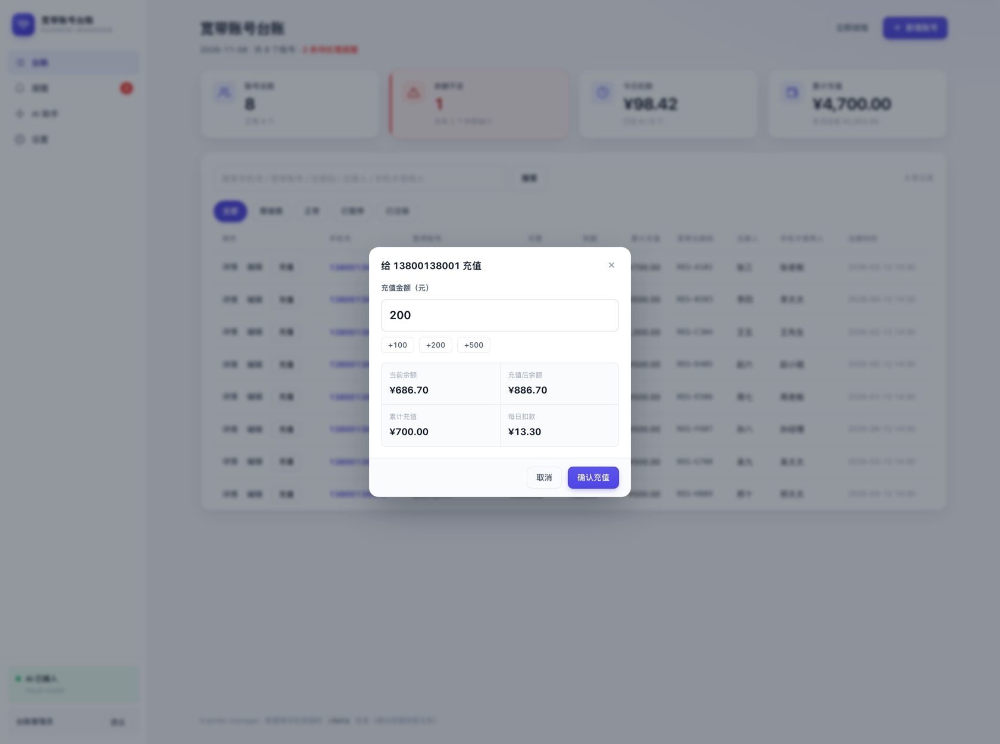 |

| 异常账号 | AI 助手 |
|---|---|
| 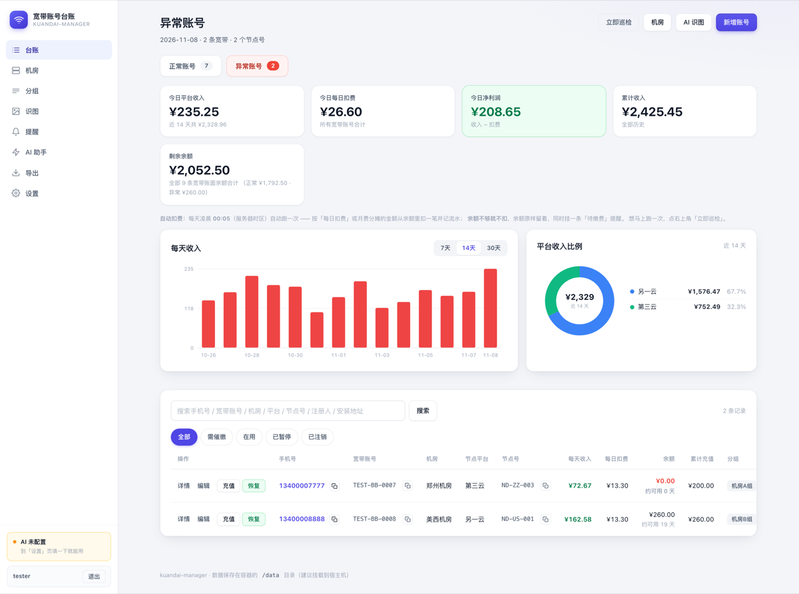 | 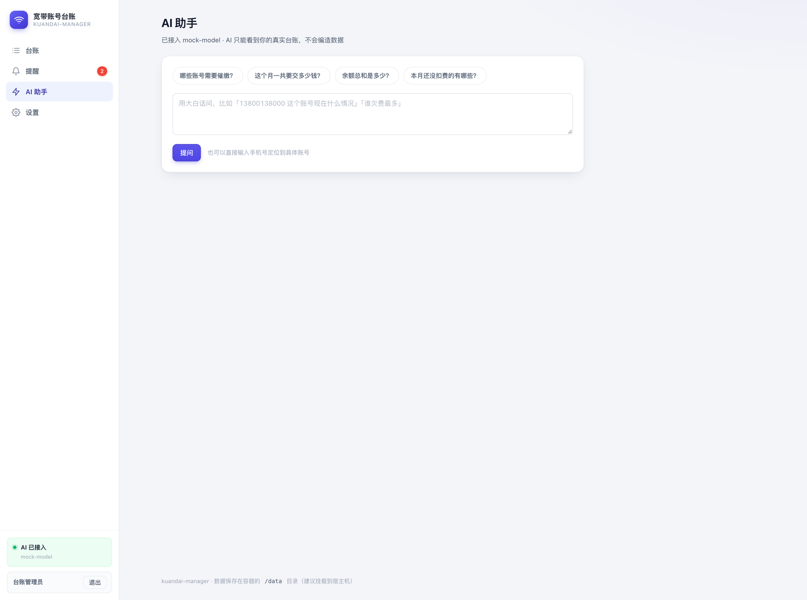 |

| 设置 | 视觉模型设置 |
|---|---|
| 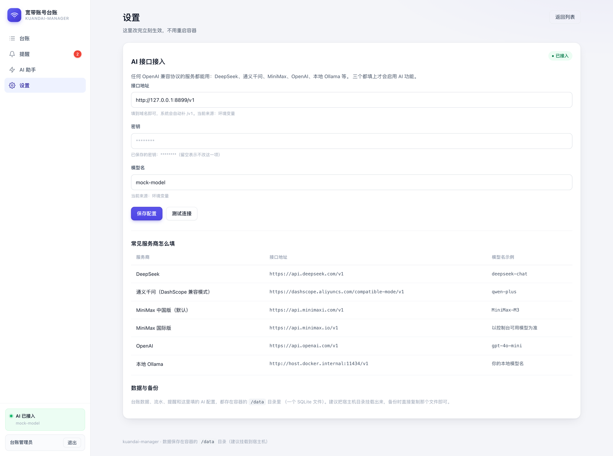 | 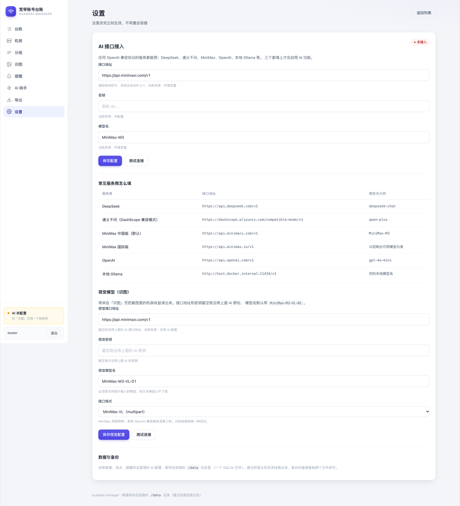 |

---

## 本地开发与测试

```bash
# 本地预览（改代码看效果，不动 NAS）
python3 -m venv .venv && .venv/bin/pip install -r requirements.txt
./scripts/dev_local.sh          # 启动，浏览器打开 http://127.0.0.1:18099
./scripts/dev_local.sh stop     # 停掉

# 灌一批演示数据（8 条假账号，号码统一 1340000xxxx）
.venv/bin/python scripts/seed_demo.py

# 跑测试
.venv/bin/python -m unittest discover -s tests -v
```

本地数据存在项目下的 `.localdata/`，跟正式数据完全分开（已在 `.gitignore` 里）。第一次打开会让你注册一个账户，注册完就能进。

测试用的是标准库 `unittest` + starlette 自带的 `TestClient`，不用额外装 pytest；测试跑在独立的临时 SQLite 库上，不会碰你的真实数据。当前基线 **82 项全绿**。

---

## 从旧版本升级

升级前**务必先备份数据目录**，迁移不可逆：

```bash
cp -a /vol1/1000/docker/kuandai-data /vol1/1000/docker/kuandai-data-backup
```

### v1.1.0 → v1.2.0（不需要数据迁移）

只换了界面和逻辑，**数据库表和字段一个没删**，所以没有迁移步骤：

```bash
docker pull ghcr.io/zozlio/kuandai-manager:latest

docker stop kuandai-manager && docker rm kuandai-manager
docker run -d --name kuandai-manager --restart unless-stopped \
  -p 18080:8080 \
  -v /vol1/1000/docker/kuandai-data:/data \
  -e TZ=Asia/Shanghai \
  kuandai-manager:latest
```

> 数据目录**原样挂回去，不要动里面的文件**。起来后打开 `http://<NAS_IP>:18080`，
> 侧边栏的「分组」入口会消失（这是 v1.2.0 的预期行为），台账数据、余额、流水、提醒都在。

### v1.0.0 → v1.1.0（会自动迁移数据结构）

v1.1.0 把 `nodes` 表拆成了账号上的机房 / 平台 / 节点号三个字段，但**不用手动跑任何脚本**：新版本第一次启动会自己迁移，只迁移一次。

```bash
cp -a /vol1/1000/docker/kuandai-data /vol1/1000/docker/kuandai-data-backup
docker pull ghcr.io/zozlio/kuandai-manager:latest
docker stop kuandai-manager && docker rm kuandai-manager
docker run -d --name kuandai-manager --restart unless-stopped \
  -p 18080:8080 -v /vol1/1000/docker/kuandai-data:/data \
  -e TZ=Asia/Shanghai kuandai-manager:latest
```

起来后开头几秒转圈属正常，机房 / 平台 / 节点号会自动填好。迁移期间别重启容器，等健康检查通过再操作。

完整的改动清单、注意事项和回滚办法见 [CHANGELOG.md](CHANGELOG.md)。

---

## 飞牛 fnOS NAS 部署（本项目在 fnOS 上实测部署成功）

> 下面的 IP、端口、目录按你自己的 NAS 改。示例用的是常见的 fnOS 约定路径。

| 项目 | 值 |
|---|---|
| 访问地址 | `http://<NAS_IP>:18080` |
| 项目目录 | `/vol1/1000/docker/kuandai-manager` |
| 数据目录 | `/vol1/1000/docker/kuandai-data`（数据库 `kuandai.db`） |
| 端口 | `18080`（**8080 已被飞牛网页端占用**，所以避开） |
| 镜像 | `kuandai-manager:latest` |

用的是 **Compose 项目**方式部署，所以在飞牛 Docker 面板的**「项目」标签页**里能看到 `kuandai-manager`，可以像别的项目一样点启停、看日志、改配置。

### 在面板里重建镜像（改完代码后）

项目目录里已经放好了 Dockerfile 和源码。在 NAS 上：

```bash
cd /vol1/1000/docker/kuandai-manager
docker build -t kuandai-manager:latest .
cd kuandai-manager && docker compose -f ../docker-compose.yml up -d
```

> **为什么 Dockerfile 默认走国内镜像站**
> 这台 NAS 上 BuildKit 直接拉 `docker.io` 会被劫持返回 HTML 页面（报 `encountered unknown type text/html`），而 `docker.m.daocloud.io` 能正常访问。所以 Dockerfile 的默认值已经写成国内镜像站 + 阿里云 pip/apt 源，**零参数直接构建即可**。要用官方源，构建时覆盖：
>
> ```bash
> docker build \
>   --build-arg PYTHON_IMAGE=python:3.13-slim \
>   --build-arg DEBIAN_MIRROR= \
>   --build-arg PIP_INDEX_URL=https://pypi.org/simple/ \
>   --build-arg PIP_TRUSTED_HOST=pypi.org \
>   -t kuandai-manager:latest .
> ```

---

## 常见问题

**Q：为什么余额每天少一点，而不是每月扣一次？**
A：套餐费按天分摊。每天扣 = 月费 ÷ 当月天数（11 月 30 天，399 ÷ 30 ≈ ¥13.30/天）。这样你随时打开列表都能看到「这个月还剩多少钱」，不会等到月底才发现扣不动。

**Q：七折打开后还能关吗？**
A：不能。前端开关会变成灰色不可点，后端也会直接忽略关闭请求。这是故意的——套餐价反复改会让历史流水对不上账。

**Q：宽带账号能改吗？**
A：v1.2.0 起可以改（以前是建完锁死的）。改成别的号码时会先查是否被其他账号占用，占用会提示「该宽带账号已存在」；留空则保持原值。

**Q：分组 / 安装地址怎么不见了？**
A：v1.2.0 主动下线了。分组是纯标签、安装地址和「机房」重复，界面入口都撤了，但**数据库里表和字段都还在，历史数据一条没丢**，全量备份 JSON 也能完整导出。详见上面的「退役功能登记」。

**Q：账号详情页的「发起催缴」按钮呢？**
A：v1.2.0 移除了手动催缴入口。自动催缴不受影响——余额不足时系统仍然会自己生成待缴费提醒，催缴页也能一键生成话术。

**Q：改了月费或余额，但自动扣费没反应？**
A：自动扣费在每天凌晨执行（`DAILY_CHECK_HOUR`）。想立刻执行，列表页点「立即巡检」。

**Q：累计充值和余额有什么区别？**
A：余额是现在还剩多少；累计充值是这个账号从开号到现在一共充过多少钱（开号送的 500 也算）。累计充值只增不减，用来对账。

**Q：客户已经充值了，但提醒还在？**
A：列表页点「充值」把余额补上，相关提醒会自动关闭。

**Q：AI 提示「未配置」？**
A：到左侧「设置」页填上接口地址、密钥、模型名，保存就生效；不用管环境变量。（环境变量只在你没在页面上填的时候才生效，而且 `docker run` 的 `-e` 只在创建容器时生效。）

**Q：识图老是识别不出来 / 报超时？**
A：两件事：① 视觉模型得是**支持图像输入**的（纯文本模型不行）；② 图信息量大时把 `VISION_TIMEOUT`（默认 300 秒）和 `AI_MAX_TOKENS`（默认 8192）调大。识别结果会先进确认表，认错了可以每行手动选账号、改日期再确认。

**Q：账户名和密码有什么格式要求？**
A：**没有要求**。中文、英文、数字、空格、特殊符号都行，只要不是空的。账户名不区分大小写（`Admin` 和 `admin` 算同一个），密码原样保存、不做长度或复杂度限制。

**Q：第一个注册的人就是管理员吗？**
A：是。第一次打开首页会让你「创建管理员账户」，建出来的就是管理员。之后首页还能继续注册新账户，**默认都是普通用户**，谁都能进来看台账。

**Q：密码忘了登不进去怎么办？**
A：目前没有「找回密码」功能（密码是加密存着的，系统也读不出来）。最省事的办法是停掉容器，把数据目录里 `kuandai.db` 的 `users` 表对应记录处理掉，再重新注册；或者直接删掉整个数据库文件重来（**会连台账数据一起没了，记得先备份**）。

**Q：怎么改定时任务的时间？**
A：重启容器前改 `-e DAILY_CHECK_HOUR=3 -e DAILY_CHECK_MINUTE=0`。

---

## 上线建议

- 自带登录验证，但密码不设复杂度要求（按需求不限制格式），所以：
  - 放在内网或专线后面最稳妥
  - 对外开放时，前面加一层 Nginx 做 HTTPS，并把 `SESSION_COOKIE_SECURE` 设成 `true`：

    ```nginx
    location / {
        proxy_pass http://127.0.0.1:8080;
        proxy_buffering off;   # 流式输出必须关缓冲
        proxy_read_timeout 600s;
        proxy_set_header Host $host;
        proxy_set_header X-Real-IP $remote_addr;
    }
    ```
- 换模型不用重建镜像：直接在「设置」页改模型名保存即可（也可以改 `-e` 环境变量后重启容器）

---

## License

[MIT](LICENSE) © 2026 zozlio
